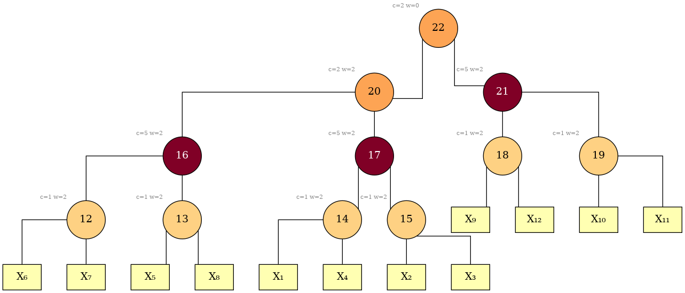

# Vtrees

A **vtree** (variable tree) is a rooted binary tree whose leaves are the
variables of the formula, one leaf each — a recursive partition of the variable
set, carrying no Boolean content of its own. This package builds several, scores
them against the CNF, and returns the best by those scores. The emitted file and
the rest of the bundle are in [`bundle.md`](bundle.md).

The trees this library builds are **unordered**: at each internal node the two
children are a partition of that node's variables into two sets, and which one
is written or drawn as "left" and which as "right" carries no meaning. A
consumer that needs an ordered vtree chooses that order itself.

## The portfolio

The default `--vtree` spec is a **portfolio**. It walks an ordered catalog,
builds a vtree with each construction that passes its gate, scores every result
against the CNF, and selects a winner with the ranker shipped in the crate
(`VITRI_SCORE_AGG` in [`env.md`](env.md) names another, or the structural cost
alone). When the formula has a show set, as under `pmc` and `pwmc`, it selects
on peak context width over the show variables instead
(`decompose::SelectionObjective`). The catalog, in order:
`flowcutter-incidence`, `flowcutter-primal`, `goatd-incidence`, `goatd-primal`,
`force`, `hypergraph-bisect` and `guided-bisect`; what each builds is in the
base table below. A default build leaves out `goatd-primal`,
`hypergraph-bisect` and `guided-bisect` (`decompose::DEFAULT_SKIP`), and
`VITRI_PORTFOLIO_SKIP` replaces that list. A bundle names the winner as a spec
that rebuilds it (`SelectionRecord::winning_spec`).

Under a budget the portfolio stops starting candidates once its share is spent,
though it always attempts one. `VtreeBuild::limits` names the candidates it
skipped, and `VtreeBuild::construction_ms` is the construction wall.

A build runs per independent component by default and grafts the pieces into
one whole-formula vtree (`--components`, `ComponentPolicy`); `components.json`
([`bundle.md`](bundle.md)) records the split. A small component is built with
`minfill-primal` whatever the spec (`ComponentPolicy::Split`), and components
that are the same up to a renaming of their variables are built once
(`VtreeBuild::cached_components`).

A portfolio build of a large, clause-dense `--mode compile` reduction that
splits without one dominant component builds every component with `force`
(`SelectionCtx::preserves_function`).

## From a tree decomposition to a vtree

A tree decomposition does not name a vtree by itself: it has to be rooted,
each variable placed in one of its bags, and each bag binarized. Those three
choices are a **reading**, `decompose::Reading`, whose dimensions are the
`root`, `place` and `binarize` keys of a spec; the values each takes, and what
each does to the tree, are on `decompose::Root`, `decompose::Place` and
`decompose::Binarization`. A dimension left open is searched, and `--budget-ms`
cuts that search short between readings, never before the first has finished.
The portfolio's decomposition candidates leave all three open;
`RunConfig::reading` fixes any of them for every family a run builds with.

The conversion is `decompose::td_to_vtree`; `decompose::td_to_vtree_reading` is
the same one with the formula, the reading and a deadline passed in.

A conversion made for a `--vtree` spec reports on stderr the reading it kept,
what that reading scored and how many readings it got through, when
diagnostics are on: `vitri` turns them on, and a library caller does with
`diagnostics::set_verbose`. `VITRI_CONVERSION_TRACE` ([`env.md`](env.md)) adds
a line per reading.

## The `--vtree` specs

Every spec other than `portfolio` names a single construction. The single
elimination orders build from one order, unrefined and unscheduled; `minfill`
and `mindegree` can break ties by sampling weighted by the SAT-aware
Jeroslow-Wang score (`ties=jw-sample`). `GoatdKnobs` exposes the final
refinement of [goatd](https://github.com/Tractables/goatd) through
`GoatdPolishing` and projection-and-lift through `GoatdLift`.

### The grammar

```text
spec   := base [ ":" params ]
params := key "=" value { "," key "=" value }
```

A parameter is always written with its key, and each key at most once.

Every base, with the parameters it takes:

| base | builds | parameters |
|---|---|---|
| `portfolio` | the catalog above, best-scoring candidate wins | — |
| `flowcutter-primal` | FlowCutter decomposition of the primal graph (variables only, edges for co-occurrence) | `budget` `iters` `patience` `root` `place` `binarize` |
| `flowcutter-incidence` | the same on the incidence graph (variables and clauses as vertices) | as `flowcutter-primal` |
| `goatd-primal` | goatd's scheduled elimination with safe reductions and a refinement pass, primal graph | `seed` `refine` `candidate` `root` `place` `binarize` |
| `goatd-incidence` | the same on the incidence graph | as `goatd-primal` |
| `guided-bisect` | recursive primal bisection with the incidence decomposition offered at every level; a construction rather than a reading, so it takes no conversion key | `budget` `iters` `patience` |
| `hypergraph-bisect` | multilevel bisection of the clause hypergraph, recursive rather than decomposition-derived | `imbalance` |
| `primal-bisect` | the same multilevel core on the primal graph | `imbalance` |
| `minfill-primal`, `minfill-incidence` | min-fill elimination order | `seed` `ties` `root` `place` `binarize` |
| `mindegree-primal`, `mindegree-incidence` | min-degree elimination order | `seed` `ties` `root` `place` `binarize` |
| `nested-dissection-primal`, `nested-dissection-incidence` | nested-dissection order | `seed` `root` `place` `binarize` |
| `force` | force-directed embedding, tree-ified by minimum spanning tree or median cut | `treeify` `root` `orient` `weights` `feedback` `clause-weight` `dim` `restarts` `init` |
| `balanced`, `linear`, `reverse-linear`, `random` | the variable numbering alone | — |

Every family that decomposes a graph view of the CNF names the view it runs on;
the rest carry no view. `nested-dissection` breaks ties deterministically only,
so it takes no `ties`. An elimination order is one decomposition and the
FlowCutter and goatd families produce one too, so all of them take the same
three conversion keys.

`vitri --help` prints every parameter with its values, its default and what it
changes, rendered from the table the parser matches against;
`spec::spec_param_docs` returns the same rows to a library caller.

`root`, `place` and `binarize` are the three dimensions of a reading, described
under *From a tree decomposition to a vtree*. `force` has a `root` of its own,
and `orient`, `weights` and `feedback` beside it, which reshape the spanning
tree; a spec naming one of those four under `treeify=cut` is refused.

### The force-directed embedding

`force` is the one construction here that does not go through a tree
decomposition or a partitioner: it places the variables as points in space and
reads a tree off the geometry. It generalizes FORCE — Aloul, Markov and
Sakallah, "FORCE: a fast and easy-to-implement variable-ordering heuristic",
GLSVLSI 2003 — from a line to several dimensions. `decompose::embed` returns
the layout without the tree.

### The baselines

`balanced`, `linear`, `reverse-linear` and `random` build from the variable
numbering alone, consulting no clause, as `Vtree::balanced`, `Vtree::linear`,
`Vtree::reverse_linear` and `Vtree::random` do. `random` runs at a fixed seed,
so it is a reproducible baseline, not a fresh tree per run.

## Budgets and reproducibility

Construction draws on no entropy: the spec, the CNF and the seed fix what each
stage attempts, but not how far it gets. goatd, the single elimination orders
and the timed FlowCutter search stop on a clock even without `--budget-ms`, so
on a large formula the tree can depend on the machine and its load. `force`,
the baselines and FlowCutter's step-budgeted spelling (`budget=<N>steps`) read
no clock. `--budget-ms` also puts the portfolio and the timed FlowCutter search
on a deadline. Under one, a portfolio build can start capped because an earlier
build sharing its `PortfolioKnobs::build_history` took longer than it has left.

`RunConfig::construction_budget` says what share of the run construction gets.
`ConstructionBudget::Deterministic` bounds construction by work instead and
selects the same vtree on any machine; `RunConfig::preprocess_clock` does the
same for the simplify chain. Arjun and the projected chain stay on the wall
clock; [`preprocessing.md`](preprocessing.md#disabling-preprocessing) says what
each mode can turn off.

## The scores

Every candidate is scored on the **realized** vtree against the component's own
CNF, not estimated from the tree decomposition it came from. All of the scores
are lower-is-better, and what each predicts is on `score::VtreeScores`, with
`cost` on `score::vtree_cost`. `candidate_rank_metric` in `components.json`
names which one the retained set is sorted by
(`ComponentsManifest::candidate_rank_metric`); the rest are emitted anyway, for
re-ranking.

## Choosing among the candidates

`--candidates N` keeps the runners-up ([`bundle.md`](bundle.md)).

"Best" above means best by the ranker the portfolio selected on, and entry 0 is
what it picked. A caller whose cost profile differs re-ranks on the score that
matches its bottleneck: `peak_context_width_all` (or `peak_context_width_show`
when projected) for the widest context, which is often *not* the metric entry 0
was chosen by, and `max_clause_load` for the largest single node.

`PortfolioKnobs::prefer` biases selection toward a named candidate, and
`PortfolioKnobs::pairwise_weighting` sets the opponent weights the pairwise
ranker uses. `FrontendSession::retry` takes Arjun and vtree overrides
for further attempts, through `FrontendRetryConfig`.

## Drawing a vtree

`--dot` writes a Graphviz `.dot` beside every `.vtree` the run emits, with the
same stem. Render one with:

```sh
dot -Tsvg vtree.dot > vtree.svg
```

The tutorial's twelve-variable formula under `--mode compile --vtree force`,
rendered with `-Gsplines=ortho`:



Every node is filled by its clause load, and each internal node is labelled
`c=<clause load> w=<context width>`; the width is counted over the show
variables on a projected instance and over all variables otherwise. The same
rendering is `vitri::dot`, whose annotation table takes a caller's own per-node
heat and label in place of these.

## Structure measurements

`decompose::conditioned_primal_width_ub` bounds the width left in the primal
graph once a set of variables is conditioned away, and
`score::StructureProfile::measure` reports clause-width and occurrence
dispersion. An embedding building a vtree for a transformed formula can hand the
source formula's profile to selection through `SelectionCtx::source_profile`;
the full pipeline measures the input itself and returns it as
`VitriRun::source_profile`.

## Your own decomposition

`PaceGraph::to_gr` and `PaceGraph::parse_td` connect any PACE-format solver to
`td_to_vtree` and validate the returned decomposition against the exported
graph; the `PaceGraph` rustdoc contains the complete round trip.

## Local search from a vtree

A caller whose cost model disagrees with these scores can keep searching from
the tree: `vitri::vtree::rotate` holds the two local moves, and its module
documentation has what a rescoring loop needs.
